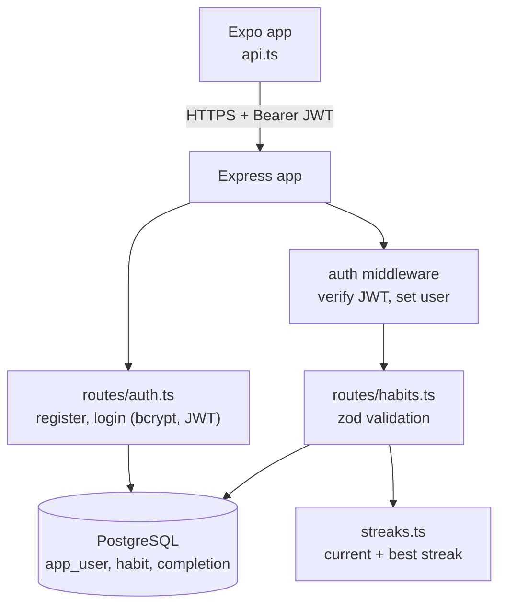
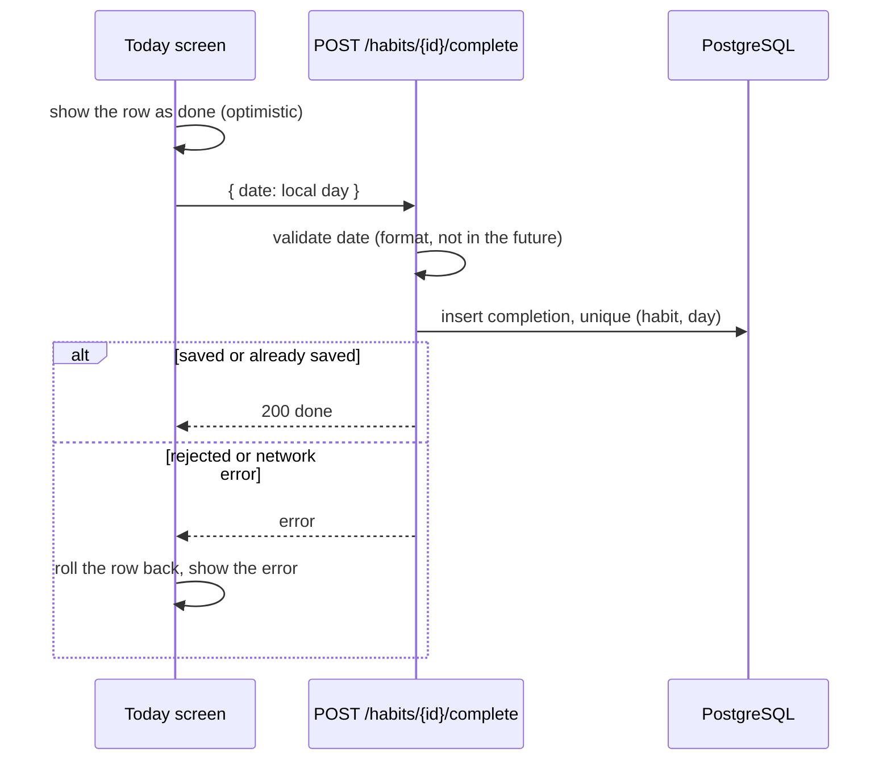
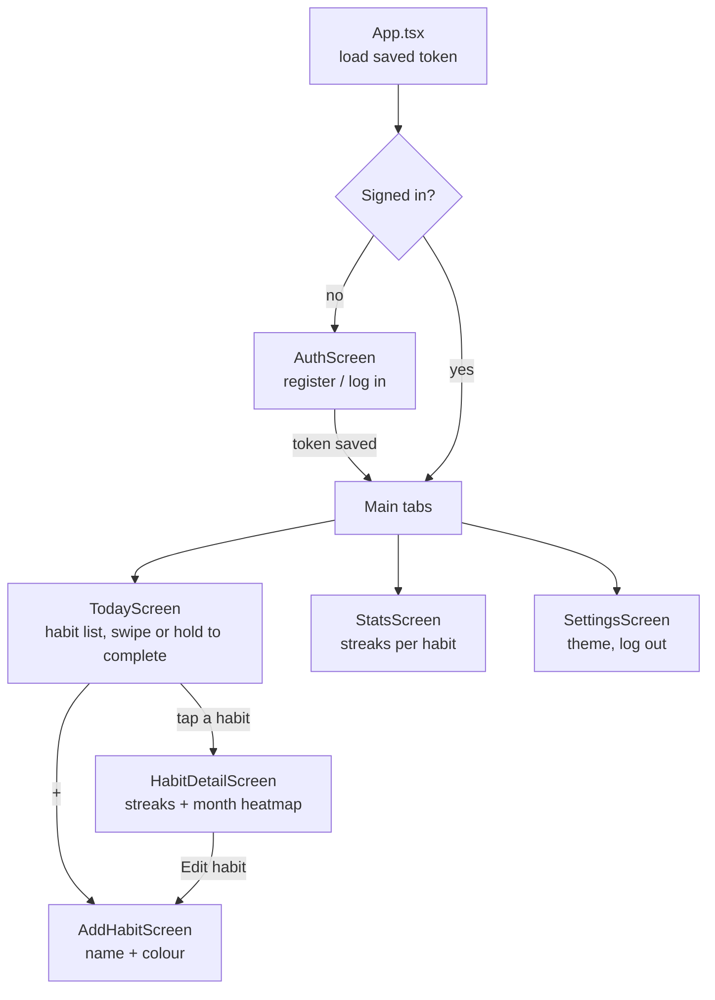
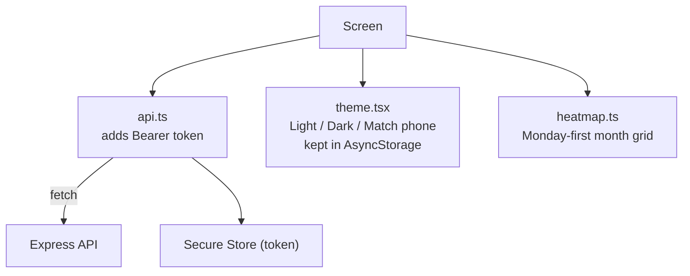

# Aadat

<p align="center">
  <a href="demo/demo.mp4"></a>
</p>

Demo walkthrough: sign up, add habits, see streaks, press and hold to complete a habit, open the monthly heatmap and stats, and switch to the dark theme. Click the animation to open the full video: [demo/demo.mp4](demo/demo.mp4). The earlier streak history shown in the demo (22 to 29 October) is seeded sample data added through the API so the streaks and heatmap have something to show; the sign-up, habits, long-press completion and settings are done live in the app.

A habit tracker with swipe-to-complete, streaks and a monthly calendar heatmap. React Native app (Expo, TypeScript) on a small Node.js + TypeScript REST API with PostgreSQL. Demo project with fake data.

## Tech stack

- **App** — React Native + Expo (TypeScript), React Navigation (tabs + stacks), React Native Gesture Handler + Reanimated for swipe-to-complete, Expo Secure Store for the auth token, AsyncStorage for the theme choice. Runs in Expo Go on a physical phone.
- **Backend** — Node.js + TypeScript, Express, PostgreSQL (`pg`), JWT auth, bcrypt password hashing, zod validation. Streaks are computed server-side on the user's local calendar days. Tests: vitest + supertest on an in-memory PostgreSQL.
- **CI** — GitHub Actions runs the backend tests and the app typecheck + unit tests on every push.

## Features

- Email + password accounts with hashed passwords and expiring JWT sessions
- Habit list with pull-to-refresh, plus empty, loading and error states
- Swipe a habit to complete it for today; the row updates immediately and rolls back if the save fails
- Streaks per habit: current streak keeps counting while today is still open, best streak ever
- Monthly calendar heatmap per habit, Monday-first
- Add and edit habits with a validated form and a colour picker
- Completing is idempotent: the same day can only be completed once
- The server validates every client-sent date and refuses future completions
- Light, Dark or Match phone theme in Settings, remembered on the device

## How to run

Backend (needs Node 20+ and PostgreSQL, or Docker for the database):

```bash
cd backend
docker compose up -d          # starts PostgreSQL
cp .env.example .env          # optional; defaults work locally
npm install
npm run migrate               # creates the tables
npm run dev                   # API on http://localhost:8081
```

Windows PowerShell one-command setup and run: `scripts\run.ps1`

App (needs Node 20+ and the Expo Go app on your phone):

```bash
cd app
npm install
EXPO_PUBLIC_API_URL=http://<your-computer-ip>:8081 npx expo start
```

Scan the QR code with Expo Go. The phone and computer must be on the same network.

Tests:

```bash
cd backend && npm test         # streak logic + API behaviour
cd app && npm test             # heatmap grid
```

## Code flow

### Backend



Completing a habit for a day:



Reading streaks: the app sends its own local "today", the server validates it, loads the completed days for the habit and `streaks.ts` computes the current and best streak on those calendar days.

### Frontend





## Repo layout

| Path | What it is |
| ---- | ---------- |
| `app/` | Expo React Native app (screens, theme, heatmap, API client) |
| `backend/` | Express API (routes, streak logic, migrations) |
| `backend/migrations/` | Database schema |
| `scripts/` | One-command setup and run |
| `demo/` | Demo video (`demo.mp4`) and preview animation |
| `.github/workflows/` | CI: backend tests, app typecheck and tests |

## Notes

- Demo project: secrets come from environment variables (see `backend/.env.example`), nothing real is committed.
- A real deployment would need its own credentials and a security review; this repo is a portfolio demo, not a production service.
